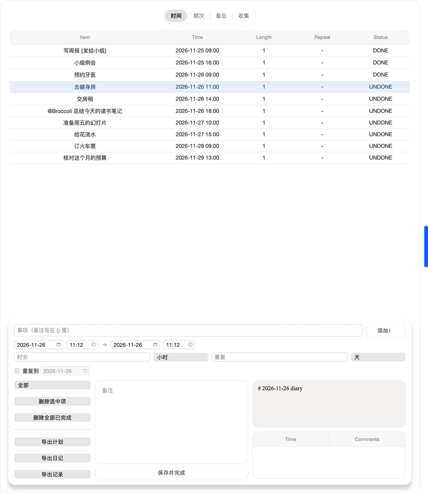
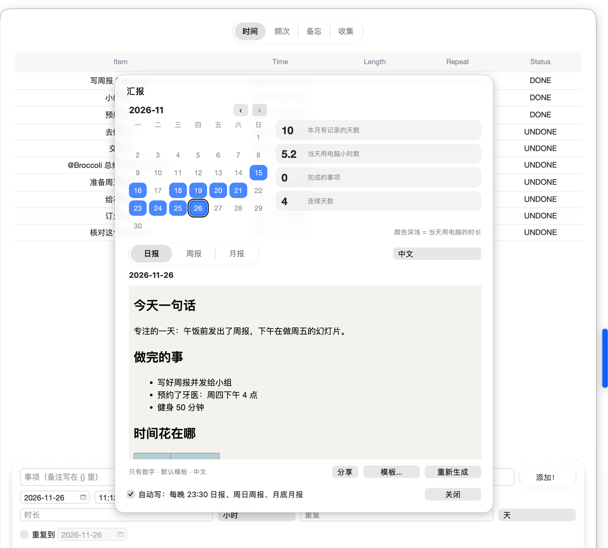
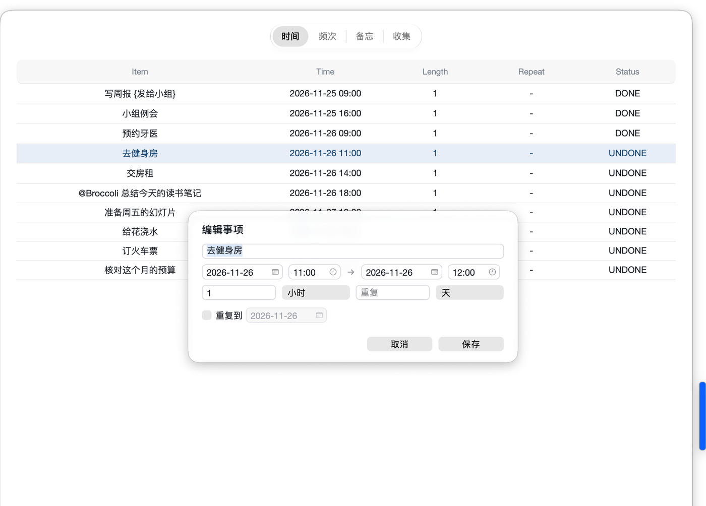
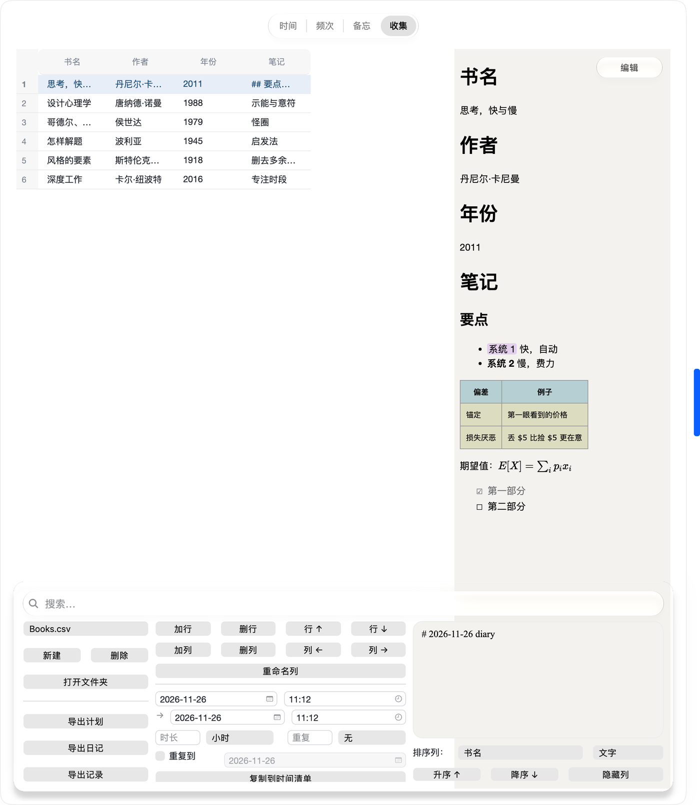

# 🍅Tomato: An Automatic Schedule Manager = Calendar + Reminders

<p align="center"><b>简体中文</b> · <a href="README_EN.md">English</a> · <a href="README_JA.md">日本語</a></p>

<p align="center">
  
  
</p>

**Tomato 是一个把「提醒事项」和「日历」合在一起的日程管理软件。** 一张表格里排计划，打一次勾，提醒事项、日历、日志和记录一起更新。它还会自动记下你每天在用什么软件，每晚出一份汇报；到点的事项可以直接交给 AI（[Broccoli](https://github.com/Ryan-the-hito/Broccoli)）去做。所有数据都是你 Mac 上的普通文件。

最新版本：**v1.2.12** · 界面语言：English / 简体中文 / 日本語

## 解决问题

macOS 自带的 Reminders 和 Calendar 在安排日程时有三个问题：

1. **两个软件并立，数据不通**

   早在 2010 年代初就有人希望把 Reminders 和 Calendar 合成一个。Apple 至今没有这样做，可能因为两者功能确有分野：Reminders 偏提醒，适合重复性的、时间敏感的小事；Calendar 偏展示，把固定的事项平铺在日历上。但两个数据库不统一，同一件事就要在两边各加一次，还容易排出互相冲突的时间。

   Tomato 是架在两者上面的一张表：在 Tomato 里加一条、改一条、完成一条，提醒事项和日历一起变；在提醒事项或日历里改了，Tomato 一两秒内跟上。

2. **只有计划，没有记录**

   Reminders 和 Calendar 只管计划和安排。做了什么、什么时候做的，要自己复制粘贴去记。记不住时间的时候，记录就成了一件成本很高的事。

   Tomato 在你把事项标成完成的那一刻，往当天的日志里加一行；重复的事项另有一张记录表，每完成一次记一次。它还可以自动记下你正在用哪个软件，晚上把一天汇总成一份汇报。

3. **不同类型的日程没有明确分类**

   有的事有确定的时间，有的事只要求「这周做够三次」，有的只是一个想法、一个模糊的时间印象。Reminders 和 Calendar 都装不下后两种。

   Tomato 把它们分成三页：Time（有时间的）、Frequency（按次数的）、Memory（备忘和想法），另有一页 Collection 放你自己的资料表。

## 功能亮点

### 一张表管提醒事项和日历

- Time 页里的事项和系统「提醒事项」里的 Tomato 列表、「日历」里的 Tomato 日历保持一致。加、改、完成、删除，三处一起变。
- Tomato 直接读写系统的提醒事项和日历，读一遍不到一秒。拿不到权限时自动退回原来经过那两个 App 的办法。
- 在提醒事项或日历里改了东西，Tomato 一两秒内跟上；同一件事两边都改了，以日历为准，不会留下两条同名的事件。
- 在提醒事项里取消打勾，Tomato 里这一条会改回未完成。
- 重复事项：打勾后自动排出后面的；菜单栏菜单「🔁 重复事项预生成次数」决定提前排出几次。删除或改时间时会先问：只这一个，还是这一个和之后的。

### 四个页面

- **Time（界面上是「时间」）**：有具体时间的事项。填事项（备注写在 `{}` 里）、开始时间、时长或结束时间、重复、重复到哪天。上方可以筛选：全部、今天、待办、过期、已完成。
- **Frequency（「频次」）**：按次数算的事项。给一个目标次数，做一次点一次「记 1 次！」；也可以复制到 Time 页排一个具体时间。
- **Memory（「备忘」）**：备忘和想法。做完点「完成这条备忘！」。
- **Collection（「收集」）**：你自己的资料表，每张表是一个 CSV 文件。列可以设成文字、数字、日期、是否；可以搜索、排序、隐藏列。选中一行可以看成排好版的 Markdown 页面，表格、高亮、任务清单和公式都排得出来（公式引擎自带，不联网）。

每一页的表格铺满整页，添加和编辑的部分是浮在表格下半部的一块玻璃面板；鼠标移过去会出现一个圆形把手，可以把面板收起来。在事项上点右键，会出现一张小卡片，可以直接改这一条。

### 计划、日志、记录连在一起

- 把事项标成完成（「保存并完成」）的那一刻，当天的日志里加一行；重复事项另有一张记录表，记下每一次完成和当时写的 Comments。
- 「👀 自动记录！」打开后，Tomato 自动把你正在用的软件记进日志。
- 把 Collection 里的一行拖进日志，就记下一条（比如吃了什么）。
- 装了 Broccoli 并打开了它的后台视觉时，它每看一次屏幕，日志里记一行（「👁 Broccoli 看到的写进日志」）。
- 几个地方同时往日志里写，不会互相盖掉。

### 汇报

- 菜单栏菜单「📊 汇报…」打开汇报窗口：月历、四个数字（本月有记录的天数、时长、完成的事项、连续天数）、日报、周报、月报。
- 每天 23:30 出一份日报。装了 Broccoli 时正文由 Broccoli 写；没有 Broccoli 时是只有数字的汇报。
- 汇报的写法可以用模板改，也可以选汇报用的语言和语气。
- 点「分享」把汇报做成一张长图：没选中文字就是整份，选中了就只做选中的部分；可以复制或另存。

### 到点交给 Broccoli

需要另外安装 [Broccoli](https://github.com/Ryan-the-hito/Broccoli)。电脑上没有时，Tomato 会先推荐下载。

- 名字以 `@Broccoli ` 开头的事项，到点自动发给 Broccoli 去做，发完自动打勾；重复事项接着发下一次。Broccoli 没开时会在后台打开它。错过的只补 24 小时以内的。
- 长的任务可以做成一个任务文件夹，里面有一份说明书。在事项框里打 `@` 会弹出任务列表；菜单栏菜单「🥦 Broccoli 任务…」是任务管理窗口；新任务可以交给 Broccoli 和你商量着写。
- 每个任务在 Broccoli 里有自己的分组，每次运行是一条新对话。有几台 Mac 时，可以给任务选一台备用 Mac。
- 自带一份「记饮食」的做法：告诉 Broccoli 吃了什么，它去 Collection 里查，把营养成分写进日志。

### AI 软件可以直接操作 Tomato

- Tomato 的功能做成了 28 个 MCP 工具：事项（列、加、改、完成、删）、日志（读、加、搜、改、删）、Collection（表、行、列的增改删）、汇报（读、存、立即出、模板、存成长图）、菜单里的开关。
- 装了 Broccoli 会自动接上，不用设置。
- 别的 AI 软件（Claude Code、Codex 等）：点菜单栏菜单「🔌 在其他 AI 软件里使用…」复制设置，贴进那个软件的 MCP 设置里。

### 窗口

- Tomato 平时收在屏幕边上，只留一条细条；点细条滑出来，再点收回去。
- 快捷键 ⌃⌥T 显示或隐藏（「⌨️ 显示/隐藏快捷键…」里可以改，不需要额外的系统权限）。
- 菜单栏菜单里的开关：「📌 始终在最上层」始终在最上层；「👀 显示/隐藏 Dock 图标」显示或隐藏 Dock 图标；「🪟 在所有空间显示」每个桌面和全屏软件上面都有。
- 「🕒 倒计时」：在菜单里列出每个事项还剩多久。
- 开着台前调度时，主窗口不会被挤到右边。

### 本地储存

Tomato 的数据都在这个文件夹里：

```
~/Library/Application Support/com.ryanthehito.tomato/TomatoAppPath
```

- `All.csv`：所有计划事项。
- `Diary/`：每天的日志。
- `Record/`：重复事项每一次完成的记录。
- `Collection/`：你的资料表，每张表一个 CSV 文件。
- `Reports/`：日报、周报、月报和它们的模板。

都是普通的 CSV 和 Markdown 文件，随时能看、能改、能备份。主界面上的「导出计划」「导出日记」「导出记录」可以把它们导出到任意位置。

从 1.2.8 或更早的版本升级时，`~/TomatoAppPath` 里的内容会在第一次打开时自动搬过来，搬完提示一次。

## 界面一览

1. Time 页：表格铺满整页，下面是添加和编辑用的玻璃面板，右下是当天的日志。

<p align="center">
  
</p>

2. 在事项上点右键，直接在小卡片里改这一条。

<p align="center">
  
</p>

3. Collection 页：左边是资料表，右边是选中那一行排好版的页面（表格、高亮、公式、任务清单）。

<p align="center">
  
</p>

4. 汇报窗口：月历、四个数字、日报 / 周报 / 月报，可以选语言、改模板、分享成长图。

<p align="center">
  
</p>

<details>
<summary>旧版截图（1.2.8 及更早，已过时）</summary>


</details>

## 环境要求

- Apple 芯片（M 系列）的 Mac。
- macOS 14.4 或更新版本。在 macOS 27 上开发和测试；液态玻璃外观需要 macOS 26 或更新，更早的系统显示同样形状的普通外观。
- 「到点交给 Broccoli」和由 AI 写正文的汇报需要另外安装 [Broccoli](https://github.com/Ryan-the-hito/Broccoli)；没有 Broccoli 时其余功能照常。

<details>
<summary>旧版环境要求（1.2.8 及更早，已过时）</summary>

- ~~MacOS（测试环境为 MacOS 12.6.5）~~
- ~~M1、M2 芯片~~

</details>

## 下载安装

1. 从 [Releases](https://github.com/Ryan-the-hito/Tomato/releases) 下载最新的 DMG。
2. 双击打开 DMG，把 Tomato 拖进「应用程序」文件夹。
3. 打开 Tomato。菜单栏会出现 🍅 图标，所有开关和设置都在它的菜单里。
4. 第一次打开时，系统会问几次权限，都点允许：
   - **提醒事项**（完全访问）：读写「Tomato」列表。
   - **日历**（完全访问）：读写「Tomato」日历。
   - **自动化**（控制「提醒事项」「日历」和 System Events）：建立 Tomato 的列表和日历，以及少数直接读写做不到的事。

   没给提醒事项或日历的权限，Tomato 也能用，只是退回原来较慢的办法。之后可以在「系统设置 › 隐私与安全性」里改。
5. **以后更新**：Tomato 启动后会在后台查一次，有新版本时更新窗口自己出来，点「立即更新」就下载、校验、替换并重新打开，数据和设置都不会丢。也可以随时点菜单栏菜单「🆕 检查更新」。
   - 从 1.2.8 或更早的版本升级，需要**手动装一次**：程序标识改成了 `com.ryanthehito.tomato`，旧版装不了新版。装好后，上面的权限要重新给一次。

<details>
<summary>旧版安装步骤（1.2.8 及更早，已过时）</summary>

1. ~~**下载**：在 Release 或者 compiled 文件夹里面找到最新的版本，下载，将解压的 .app 软件放入程序文件夹（Application）中。~~

2. ~~**打开**：在文件夹或者 launchpad 中双击打开，会弹出如下弹窗，请选择“打开”。~~

     <p align="center">
       
     </p>

3. ~~**权限**：Tomato 需要三种权限。~~

  - ~~辅助功能权限：Tomato 会请求用户的 Accessiblity 权限，请允许。Tomato 完全是一个本地软件，不会上传任何关于您的数据。~~

  - ~~读取数据权限：Tomato 需要在您的电脑中存放数据，并将这些数据存储在 Reminders 和 Calendar 中。请在弹出的这两个窗口中选择“OK”。如果在 System Preferences 里面看到对应的部分（即 Calendar 和 Reminders）的权限列表里面没有 Tomato 的话，那么请在 Terminal 里运行以下命令，即可让 Tomato 在列表中显示出来：~~

    ```sudo sqlite3 ~/Library/Application\ Support/com.apple.TCC/TCC.db "INSERT or REPLACE INTO access VALUES('kTCCServiceReminders','org.pythonmac.unspecified.Tomato',0,0,4,1,NULL,NULL,0,'UNUSED',NULL,0,1622199671)"```

    ```sudo sqlite3 ~/Library/Application\ Support/com.apple.TCC/TCC.db "INSERT or REPLACE INTO access VALUES('kTCCServiceCalendar','org.pythonmac.unspecified.Tomato',0,0,4,1,NULL,NULL,0,'UNUSED',NULL,0,1622199671)"```

    <p align="center">
      
      
    </p>

  - ~~控制软件权限：要实现对 Reminders 和 Calendar 两个软件的同步和联动控制，Tomato 就需要获得修改这两个软件数据的权限。请在弹出的对“System Events”、“Reminders”和“Calendar”三个弹窗内点击“OK”。~~

    <p align="center">
      
      
      
    </p>

</details>

## 使用说明

1. **叫出窗口**：点屏幕边上的细条，或按 ⌃⌥T，或点菜单栏 🍅 菜单里的「📝 计划 + 记录！」。再做一次就收回去。

2. **加一个有时间的事项**（Time 页）：在下面的玻璃面板里填事项名，想加备注就写在 `{}` 里；选日期和时间；填时长，或者填结束日期和结束时间（两者互相跟着变）；需要重复就填「重复」和「重复到」；点「添加！」。提醒事项和日历里会同时出现这一条。

3. **改一个事项**：双击表格里的格子直接改，改完点一下别处才算保存；或者在这一行上点右键，在弹出的小卡片里改。

4. **完成一个事项**：选中这一行，想记点什么就写在「备注」里，点「保存并完成」。当天的日志会加一行；重复事项会自动排出下一次。

5. **按次数的事项**（Frequency 页）：填事项和目标次数，每做一次点「记 1 次！」。

6. **资料表**（Collection 页）：点「新建」建一张表，或点「打开文件夹」把已有的 CSV 放进去。选中一行，点「预览」看排好版的页面。把一行拖进日志框，就记下一条。

7. **让 Broccoli 到点做事**：事项名写成 `@Broccoli ` 加要做的事，到点自动发出去。要写长一点的指令，在事项框里打 `@`，选新任务。

8. **看汇报**：菜单栏菜单「📊 汇报…」。在月历上点一天看那天的汇报，可以切换日报、周报、月报；「模板…」改汇报的写法，还可以选语言和语气；「分享」做成长图。

9. **菜单栏菜单里的其他项**：「👀 自动记录！」自动记录在用的软件，「🔄 启动时自动记录」启动时就打开它；「🌐 语言」换界面语言（重启后生效）。

## 注意事项

1. 请把电脑的时间格式设成 **24 小时制**，否则对提醒事项和日历的操作可能出错。
2. 双击修改表格里的内容后，要再点一下别处（任意一个框都可以），修改才算完成并保存。
3. 在日志框或 Comments 框里输入前，先在表格里点选一个事项，修改才会记在这一条上。
4. 从 1.2.8 或更早的版本升级：要手动装一次，然后重新给权限；数据文件夹会自动搬到新位置，同步或备份工具如果指着旧的 `~/TomatoAppPath`，请改到新位置。

## 证书信息

GPL-3.0 license

## 特别致谢

1. [Qt](https://github.com/qt) / PyQt6
2. [MathJax](https://github.com/mathjax/MathJax)
3. [pandas](https://github.com/pandas-dev/pandas)
4. ut.code(); of the University of Tokyo

## 支持作者

<p align="center">
  
  
</p>
