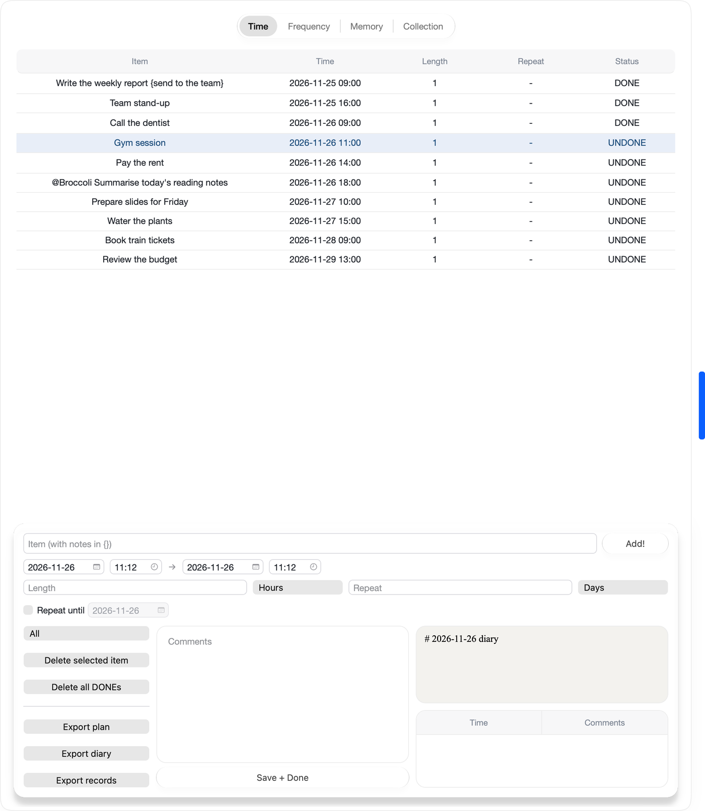
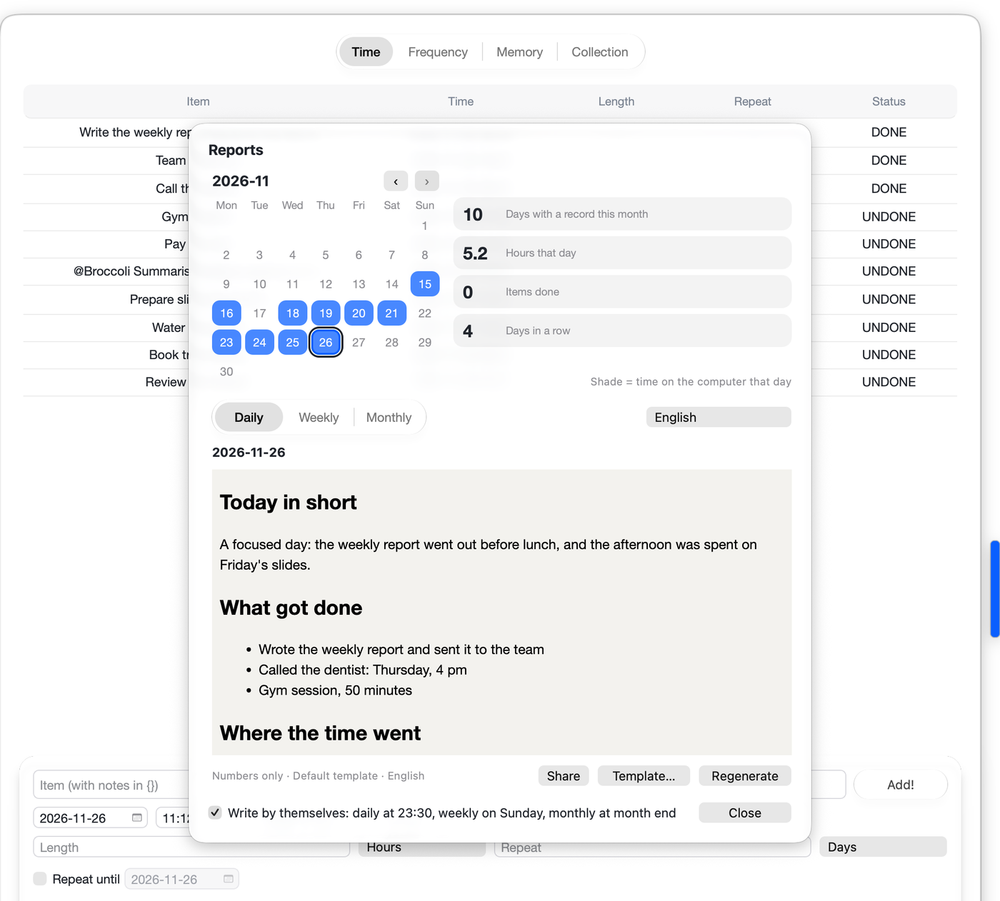
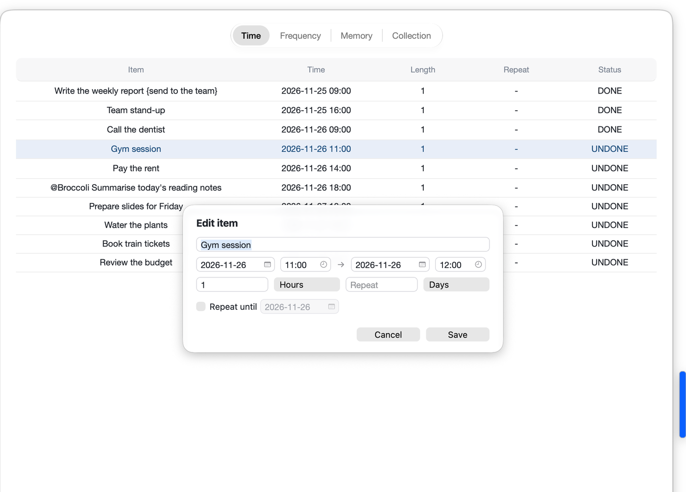
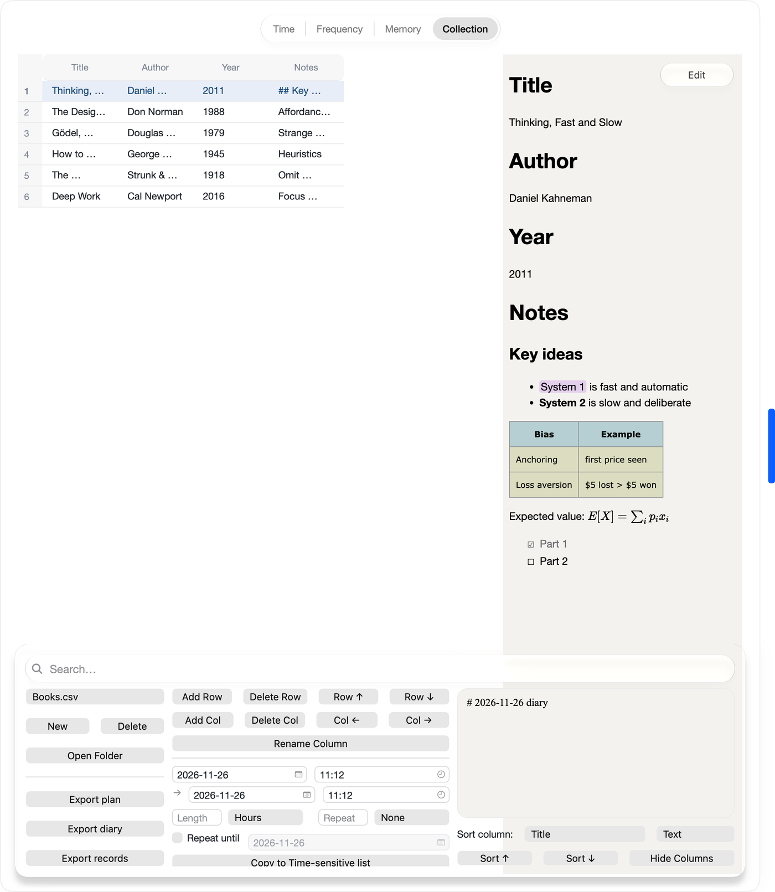

# 🍅Tomato: An Automatic Schedule Manager = Calendar + Reminders

<p align="center"><a href="README.md">简体中文</a> · <b>English</b> · <a href="README_JA.md">日本語</a></p>

<p align="center">
  
  
</p>

**Tomato is a schedule manager that puts Reminders and Calendar together.** You plan in one table; tick an item once and Reminders, Calendar, the diary and the records all follow. It can also note which apps you use during the day and write a report every evening, and it can hand an item to an AI ([Broccoli](https://github.com/Ryan-the-hito/Broccoli)) when its time comes. All of your data is ordinary files on your own Mac.

Latest version: **v1.2.12** · Interface languages: English / 简体中文 / 日本語

## What it solves

Reminders and Calendar on macOS have three problems when you plan with them:

1. **Two apps side by side, and their data does not meet**

   People have asked for Reminders and Calendar to become one app since the early 2010s. Apple has not done it, perhaps because the two really do differ: Reminders is for nudges, good for small repeating, time-sensitive things; Calendar is for showing fixed events laid out on a grid. But with two separate databases, the same thing has to be entered twice, and it is easy to plan two things into the same hour.

   Tomato is one table on top of both: add, change or finish an item in Tomato and Reminders and Calendar change with it; change something in Reminders or Calendar and Tomato follows within a second or two.

2. **Plans, but no record**

   Reminders and Calendar only plan. What you did and when is something you copy by hand, and when you cannot remember the time, keeping a record becomes expensive.

   The moment you mark an item done, Tomato adds a line to the day's diary; a repeating item also has its own record table, one line for every time it was done. Tomato can also note which app you are using, and in the evening turn the day into a report.

3. **No clear place for different kinds of plans**

   Some things have a fixed time, some only ask for "three times this week", and some are just an idea with a vague date. Reminders and Calendar have no place for the last two.

   Tomato has three pages for them: Time (things with a time), Frequency (things counted in times) and Memory (memos and ideas), plus a Collection page for tables of your own.

## Highlights

### One table for Reminders and Calendar

- The items on the Time page stay in step with the "Tomato" list in Reminders and the "Tomato" calendar in Calendar. Add, change, finish or delete, and all three change.
- Tomato reads and writes the system's reminders and calendars directly; one pass takes under a second. Without permission it falls back by itself to the old way through the two apps.
- A change made in Reminders or Calendar reaches Tomato within a second or two. When the same item was changed in both, Calendar wins, and no pair of events with the same name is left behind.
- Unticking an item in Reminders sets it back to not done in Tomato.
- Repeating items: ticking one makes the following ones; "🔁 Repeat pre-generate count" in the menu bar menu sets how many are made ahead. Deleting one or changing its time asks first: only this one, or this and later ones.

### Four pages

- **Time**: items with a time. Fill in the item (notes go in `{}`), the start, a length or an end, the repeat and "Repeat until". Filter above: All, Today, To-do, Overdue, Done.
- **Frequency**: items counted in times. Give a target and press "Add 1 time!" each time you do it; an item can also be copied to the Time page to give it a time.
- **Memory**: memos and ideas. Press "Done this memo!" when it is dealt with.
- **Collection**: tables of your own, one CSV file each. A column can be text, a number, a date or yes/no; search, sort and hide columns. A selected row can be read as a laid-out Markdown page with tables, highlights, task lists and formulas (the formula engine is built in and needs no network).

On every page the table fills the page, and adding and editing happen in a glass panel floating over its lower half; a round handle appears when the pointer comes near and puts the panel away. Right-click an item to edit it in a small card on the spot.

### Plan, diary and records together

- The moment you mark an item done (Save + Done), a line goes into the day's diary; a repeating item also has a record table with every time it was done and the comment you wrote then.
- With "👀 Auto-record!" on, Tomato writes the app you are using into the diary.
- Drag a row from a Collection into the diary to record it as a line (what you ate, for example).
- With Broccoli installed and its background vision on, each look at the screen adds a line to the diary ("👁 Broccoli's view in diary").
- Several places can write to the diary at once without overwriting each other.

### Reports

- "📊 Reports…" in the menu bar menu opens the reports window: a month calendar, four numbers (days with records this month, time, items done, days in a row), and daily, weekly and monthly reports.
- A daily report is made at 23:30. With Broccoli installed, Broccoli writes the text; without it, the report is numbers only.
- A template sets how a report is written, and you can choose the report's language and tone.
- "Share" turns a report into one long picture: the whole report, or only the selected text when some is selected. Copy it or save it.

### Hand an item to Broccoli when its time comes

This needs [Broccoli](https://github.com/Ryan-the-hito/Broccoli) installed. When it is not on the Mac, Tomato offers the download first.

- An item whose name starts with `@Broccoli ` is sent to Broccoli when its time comes and ticked off once sent; a repeating item sends its next round too. If Broccoli is not open it is opened in the background. Missed items are made up for only within 24 hours.
- A long task can be a task folder with its instructions inside. Typing `@` in the item box lists the tasks; "🥦 Broccoli tasks…" in the menu bar menu is the task manager; a new task can be written together with Broccoli.
- Each task has its own group in Broccoli, and every run is a new conversation. With several Macs, a task can name a standby Mac.
- A "log meals" procedure comes along: tell Broccoli what you ate, and it looks the food up in your Collection and writes the nutrients into the diary.

### AI apps can work Tomato directly

- Tomato's functions are 28 MCP tools: items (list, add, change, finish, delete), the diary (read, add, search, change, delete), Collections (tables, rows and columns), reports (read, save, make now, templates, save as a long picture) and the switches in the menu.
- With Broccoli installed they connect by themselves.
- Other AI apps (Claude Code, Codex and others): "🔌 Use in other AI apps…" in the menu bar menu copies the settings to paste into that app's MCP settings.

### Window

- Tomato rests at the edge of the screen with only a thin strip showing; click the strip to slide it out and again to put it back.
- ⌃⌥T shows or hides it ("⌨️ Show/Hide shortcut…" changes the shortcut; no extra system permission is needed).
- Switches in the menu bar menu: "📌 Always on top"; "👀 Show/Hide dock icon"; "🪟 Show on all Spaces" (on every desktop and over full-screen apps).
- "🕒 Countdown" lists in the menu how long is left for each item.
- With Stage Manager on, the main window is not pushed to the right.

### Kept on your Mac

All of Tomato's data is in this folder:

```
~/Library/Application Support/com.ryanthehito.tomato/TomatoAppPath
```

- `All.csv`: every planned item.
- `Diary/`: the diary, one file a day.
- `Record/`: the records of repeating items, one line for each time done.
- `Collection/`: your tables, one CSV file each.
- `Reports/`: daily, weekly and monthly reports and their templates.

They are ordinary CSV and Markdown files you can read, change and back up at any time. "Export plan", "Export diary" and "Export records" in the main window copy them anywhere you like.

Coming from 1.2.8 or earlier, what is in `~/TomatoAppPath` is moved here by itself on first start, and Tomato tells you once.

## Screenshots

1. The Time page: the table fills the page; below it the glass panel for adding and editing, and the day's diary at the lower right.

<p align="center">
  
</p>

2. Right-click an item to edit it in a small card on the spot.

<p align="center">
  
</p>

3. The Collection page: the table on the left, the selected row as a laid-out page on the right (table, highlight, formula, task list).

<p align="center">
  
</p>

4. The reports window: month calendar, four numbers, daily / weekly / monthly reports; choose the language, change the template, share as a long picture.

<p align="center">
  
</p>

Screenshots of 1.2.8 and earlier are kept, folded, in the [Chinese README](README.md).

## Requirements

- A Mac with Apple silicon (M series).
- macOS 14.4 or newer. Developed and tested on macOS 27; the Liquid Glass look needs macOS 26 or newer, and earlier systems get the same shapes in the ordinary look.
- Handing items to Broccoli and reports with AI-written text need [Broccoli](https://github.com/Ryan-the-hito/Broccoli); everything else works without it.

## Install

1. Download the latest DMG from [Releases](https://github.com/Ryan-the-hito/Tomato/releases).
2. Open the DMG and drag Tomato into the Applications folder.
3. Open Tomato. A 🍅 icon appears in the menu bar; every switch and setting is in its menu.
4. On first start the system asks for a few permissions; allow them:
   - **Reminders** (full access): to read and write the "Tomato" list.
   - **Calendars** (full access): to read and write the "Tomato" calendar.
   - **Automation** (Reminders, Calendar and System Events): to set up Tomato's list and calendar, and for the few things the direct way does not cover.

   Without the Reminders or Calendars permission Tomato still works, the old slower way. You can change them later in System Settings › Privacy & Security.
5. **Updating later**: Tomato checks once in the background after it starts; when there is a newer version the update window opens by itself, and "Update Now" downloads, checks, replaces and reopens it. Your data and settings stay. "🆕 Check for Updates" in the menu bar menu checks at any time.
   - Coming from 1.2.8 or earlier, **install by hand once**: the app's identifier is now `com.ryanthehito.tomato`, and the old version cannot install the new one. Afterwards, give the permissions above once more.

## How to use

1. **Bring the window out**: click the thin strip at the edge of the screen, or press ⌃⌥T, or choose "📝 Plan + record!" in the 🍅 menu. Do the same again to put it back.

2. **Add an item with a time** (Time page): in the glass panel, type the item's name, with notes in `{}` if you like; choose the date and time; give a length, or an end date and end time (each follows the other); fill in "Repeat" and "Repeat until" if it repeats; press "Add!". The item appears in Reminders and Calendar at the same time.

3. **Change an item**: double-click a cell of the table and type, then click somewhere else to save; or right-click the row and change it in the small card.

4. **Finish an item**: select the row, write a note in "Comments" if you like, and press "Save + Done". A line goes into the day's diary; a repeating item gets its next round.

5. **Items counted in times** (Frequency page): give the item and its target, and press "Add 1 time!" each time you do it.

6. **Tables of your own** (Collection page): "New" makes a table, "Open Folder" lets you put CSV files you already have there. Select a row and press "Preview" for the laid-out page. Drag a row into the diary box to record it.

7. **Let Broccoli do something at a set time**: name the item `@Broccoli ` followed by what to do; it is sent when its time comes. For longer instructions, type `@` in the item box and choose the new task.

8. **Read the reports**: "📊 Reports…" in the menu bar menu. Click a day in the calendar for that day's report and switch between daily, weekly and monthly; "Template…" changes how reports are written, and you can choose the language and tone; "Share" makes the long picture.

9. **Other items in the menu bar menu**: "👀 Auto-record!" records the apps you use, "🔄 Auto-record on startup" turns it on at start; "🌐 Language" changes the interface language (after a restart).

## Notes

1. Set the Mac's clock to **24-hour time**; otherwise work with Reminders and Calendar may go wrong.
2. After double-clicking a cell and changing it, click somewhere else (any box will do); only then is the change finished and saved.
3. Before typing in the diary box or the Comments box, select an item in the table, so the change is recorded for that item.
4. Coming from 1.2.8 or earlier: install by hand once and give the permissions again; the data folder moves by itself, so point any sync or backup tool that used `~/TomatoAppPath` at the new place.

## License

GPL-3.0 license

## Thanks

1. [Qt](https://github.com/qt) / PyQt6
2. [MathJax](https://github.com/mathjax/MathJax)
3. [pandas](https://github.com/pandas-dev/pandas)
4. ut.code(); of the University of Tokyo

## Support the author

<p align="center">
  
  
</p>
