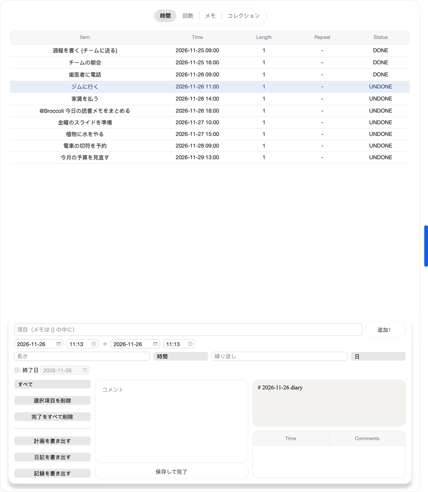
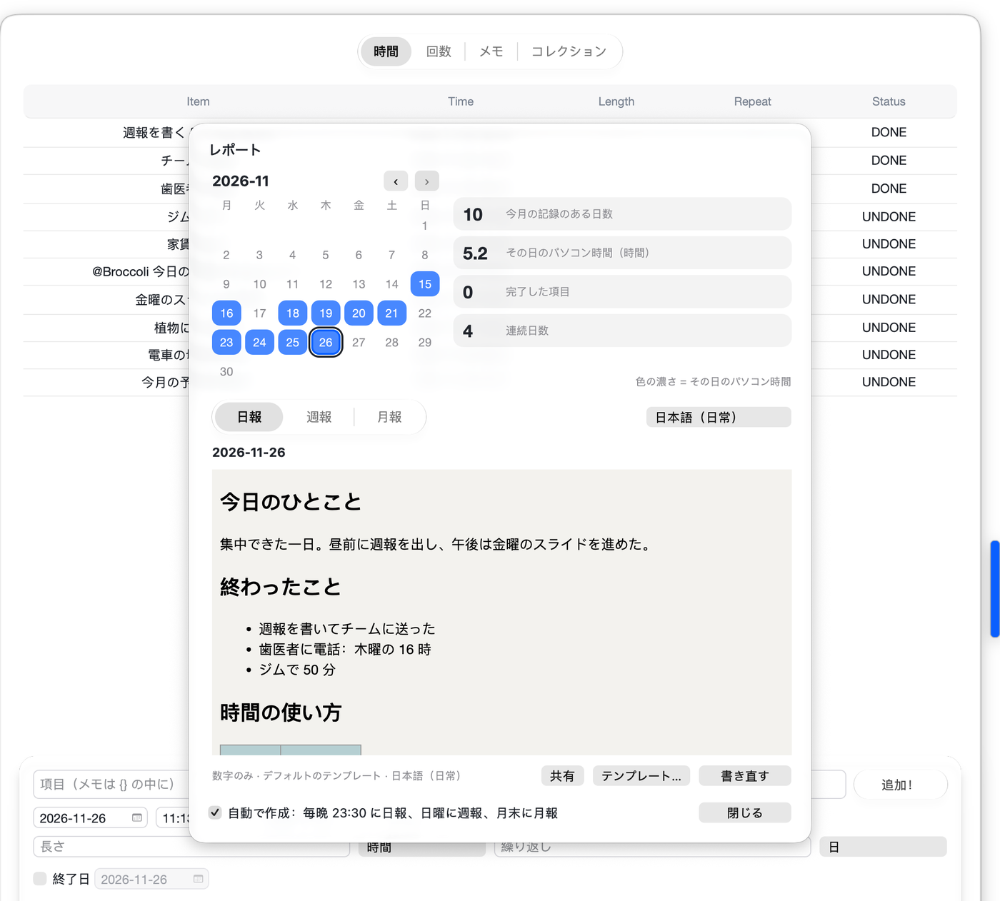
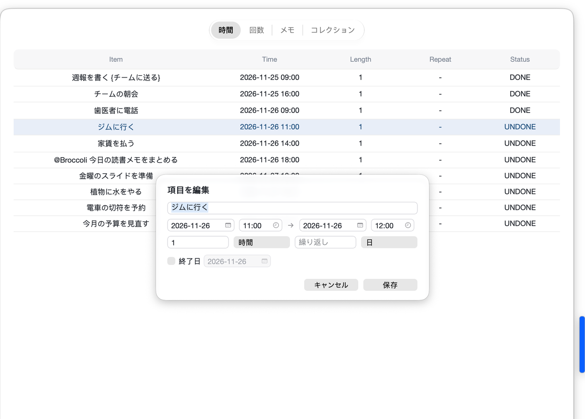
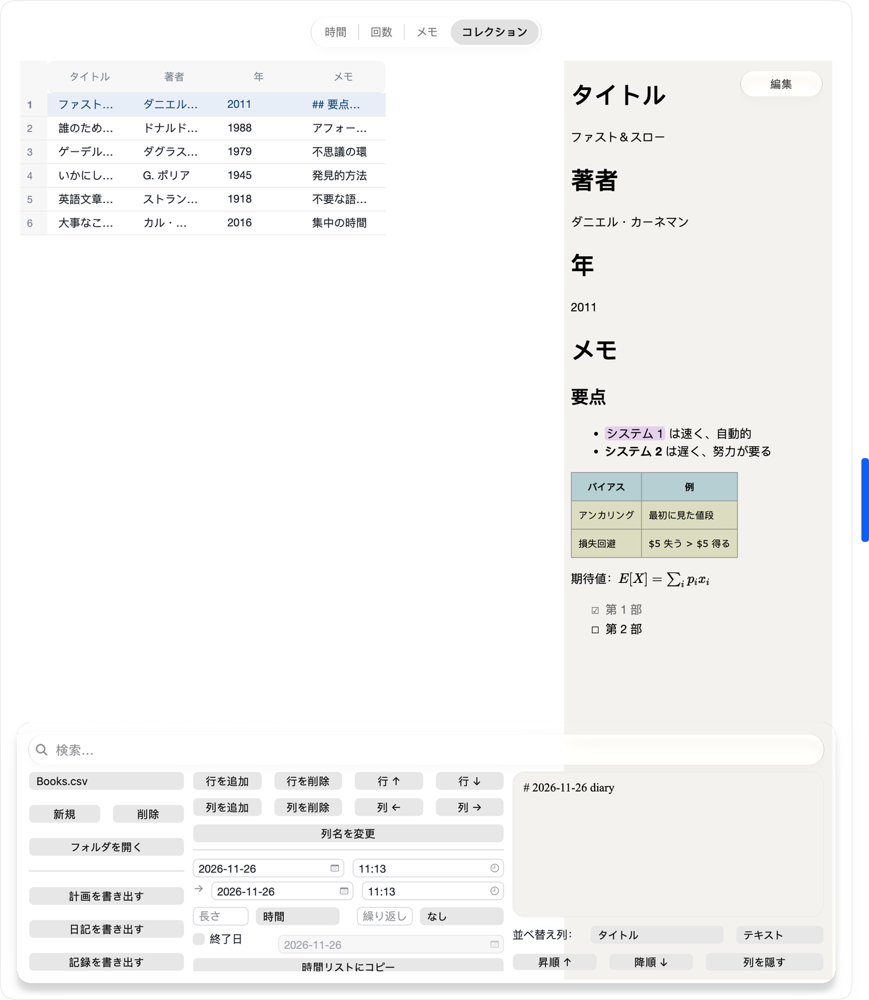

# 🍅Tomato: An Automatic Schedule Manager = Calendar + Reminders

<p align="center"><a href="README.md">简体中文</a> · <a href="README_EN.md">English</a> · <b>日本語</b></p>

<p align="center">
  
  
</p>

**Tomato は「リマインダー」と「カレンダー」を一つにまとめた予定管理アプリです。** 一枚の表で予定を立て、一度チェックを付けるだけで、リマインダー、カレンダー、日誌、記録がまとめて更新されます。一日に使ったアプリを自動で記録して毎晩レポートを作り、時刻になった項目をそのまま AI（[Broccoli](https://github.com/Ryan-the-hito/Broccoli)）に任せることもできます。データはすべて、あなたの Mac にある普通のファイルです。

最新バージョン：**v1.2.12** · 画面の言語：English / 简体中文 / 日本語

## 解決したいこと

macOS 標準のリマインダーとカレンダーで予定を立てると、三つの問題があります。

1. **二つのアプリが並んでいて、データがつながらない**

   リマインダーとカレンダーを一つにしてほしいという声は 2010 年代の初めからありました。Apple がそうしないのは、二つに役割の違いがあるからかもしれません。リマインダーは知らせるためのもので、繰り返しの細かい用事に向きます。カレンダーは見せるためのもので、決まった予定を並べます。しかしデータベースが別々なので、同じ用事を両方に入れることになり、時間がぶつかる予定も作りやすくなります。

   Tomato は二つの上に載る一枚の表です。Tomato で追加、変更、完了すると、リマインダーとカレンダーも一緒に変わります。リマインダーやカレンダーで変えれば、Tomato は 1〜2 秒で追いつきます。

2. **計画はあるが、記録がない**

   リマインダーとカレンダーは計画を扱うだけです。何をいつしたかは、自分でコピーして残すしかありません。時刻を覚えていないと、記録は手間のかかる作業になります。

   Tomato は、項目を完了にした瞬間にその日の日誌へ 1 行加えます。繰り返しの項目には専用の記録表があり、完了するたびに 1 行増えます。いま使っているアプリを自動で記録し、夜に一日をレポートにまとめることもできます。

3. **種類の違う予定に、はっきりした置き場がない**

   時刻が決まっている用事もあれば、「今週 3 回」だけ決まっている用事、ぼんやりした思いつきもあります。リマインダーにもカレンダーにも、あとの二つの置き場がありません。

   Tomato はそれらを三つのページに分けます：Time（時刻のあるもの）、Frequency（回数で数えるもの）、Memory（メモと思いつき）。さらに、自分の資料の表を置く Collection ページがあります。

## 主な機能

### 一枚の表でリマインダーとカレンダーを管理

- Time ページの項目は、リマインダーの「Tomato」リスト、カレンダーの「Tomato」カレンダーと常にそろっています。追加、変更、完了、削除が三か所に同時に反映されます。
- Tomato はシステムのリマインダーとカレンダーを直接読み書きし、一回の読み込みは 1 秒未満です。許可が得られないときは、二つのアプリを経由する以前の方法に自動で戻ります。
- リマインダーやカレンダーで変更すると、Tomato は 1〜2 秒で追いつきます。同じ項目を両方で変えた場合はカレンダーを優先し、同じ名前のイベントが二つ残ることはありません。
- リマインダーでチェックを外すと、Tomato でもその項目が未完了に戻ります。
- 繰り返しの項目：チェックを付けると次の回が自動で作られます。メニューバーのメニュー「🔁 繰り返しの事前生成回数」で、先に何回分作るかを決めます。削除または時刻変更のときは先に尋ねます：この一つだけか、これ以降すべてか。

### 四つのページ

- **Time（画面では「時間」）**：時刻のある項目。項目（メモは `{}` の中に）、開始時刻、長さまたは終了時刻、繰り返し、繰り返しの終了日を入力します。上で絞り込めます：すべて、今日、未完了、期限切れ、完了。
- **Frequency（「回数」）**：回数で数える項目。目標の回数を決め、1 回やるたびに「1 回追加！」を押します。Time ページにコピーして時刻を付けることもできます。
- **Memory（「メモ」）**：メモと思いつき。済んだら「このメモを完了！」を押します。
- **Collection（「コレクション」）**：自分の資料の表。表ごとに CSV ファイル一つです。列は文字、数字、日付、はい／いいえにでき、検索、並べ替え、列の非表示ができます。行を選ぶと、整形された Markdown のページとして見られます。表、ハイライト、タスクリスト、数式を表示します（数式エンジンは同梱で、ネットワークを使いません）。

どのページも表がページいっぱいに広がり、追加と編集の部分は表の下半分に浮かぶガラスのパネルです。ポインタを近づけると丸いハンドルが現れ、パネルをしまえます。項目を右クリックすると小さなカードが開き、その場で編集できます。

### 計画、日誌、記録がつながる

- 項目を完了にした瞬間（「保存して完了」）、その日の日誌に 1 行加わります。繰り返しの項目には記録表があり、完了した各回とそのとき書いた Comments が残ります。
- 「👀 自動記録！」をオンにすると、使っているアプリを Tomato が自動で日誌に記録します。
- Collection の行を日誌にドラッグすると、1 行記録されます（食べたものなど）。
- Broccoli を入れてバックグラウンドビジョンをオンにしていると、画面を見るたびに日誌へ 1 行記録されます（「👁 Broccoli が見た内容を日誌に書く」）。
- 複数の場所から同時に日誌へ書き込んでも、互いに上書きしません。

### レポート

- メニューバーのメニュー「📊 レポート…」でレポートウインドウが開きます：月のカレンダー、4 つの数字（今月の記録がある日数、時間、完了した項目、連続日数）、日報・週報・月報。
- 毎日 23:30 に日報を作ります。Broccoli があれば本文は Broccoli が書き、なければ数字だけのレポートになります。
- レポートの書き方はテンプレートで変えられます。レポートの言語と口調も選べます。
- 「共有」でレポートを 1 枚の長い画像にします。文字を選択していなければ全体、選択していればその部分だけです。コピーまたは別名で保存できます。

### 時刻になったら Broccoli に任せる

[Broccoli](https://github.com/Ryan-the-hito/Broccoli) のインストールが必要です。Mac にないときは、Tomato が先にダウンロードを案内します。

- 名前が `@Broccoli ` で始まる項目は、時刻になると自動で Broccoli に送られ、送ったあと自動でチェックが付きます。繰り返しの項目は次の回も送ります。Broccoli が開いていなければバックグラウンドで開きます。逃した分は 24 時間以内のものだけ送り直します。
- 長いタスクは、説明書の入ったタスクフォルダにできます。項目欄に `@` を入力するとタスクの一覧が出ます。メニューバーのメニュー「🥦 Broccoli タスク…」はタスク管理ウインドウです。新しいタスクは、Broccoli と相談しながら書いてもらえます。
- タスクごとに Broccoli のグループができ、実行のたびに新しい会話になります。Mac が複数あるときは、タスクに予備の Mac を選べます。
- 「食事を記録する」手順が付いています。食べたものを Broccoli に伝えると、Collection を調べて栄養成分を日誌に書きます。

### AI アプリから Tomato を直接操作

- Tomato の機能は 28 個の MCP ツールになっています：項目（一覧、追加、変更、完了、削除）、日誌（読む、追加、検索、変更、削除）、Collection（表、行、列の追加・変更・削除）、レポート（読む、保存、すぐ作る、テンプレート、長い画像として保存）、メニューのスイッチ。
- Broccoli を入れていれば自動でつながり、設定は不要です。
- ほかの AI アプリ（Claude Code、Codex など）：メニューバーのメニュー「🔌 ほかの AI アプリで使う…」で設定をコピーし、そのアプリの MCP 設定に貼り付けます。

### ウインドウ

- Tomato はふだん画面の端にしまわれ、細いバーだけが見えています。バーをクリックするとスライドして出てきて、もう一度クリックすると戻ります。
- ⌃⌥T で表示・非表示を切り替えます（「⌨️ 表示/非表示のショートカット…」で変更できます。追加のシステム権限は必要ありません）。
- メニューバーのメニューのスイッチ：「📌 常に手前に表示」常に手前、「👀 Dock アイコンを表示/非表示」Dock アイコンの表示・非表示、「🪟 すべての操作スペースに表示」すべてのデスクトップとフルスクリーンのアプリの上に表示。
- 「🕒 カウントダウン」：各項目まであとどれくらいかをメニューに並べます。
- ステージマネージャをオンにしていても、メインウインドウは右へ押されません。

### データは Mac の中に

Tomato のデータはすべてこのフォルダにあります：

```
~/Library/Application Support/com.ryanthehito.tomato/TomatoAppPath
```

- `All.csv`：すべての予定項目。
- `Diary/`：日ごとの日誌。
- `Record/`：繰り返しの項目を完了した各回の記録。
- `Collection/`：資料の表。表ごとに CSV ファイル一つ。
- `Reports/`：日報、週報、月報とそのテンプレート。

どれも普通の CSV と Markdown のファイルで、いつでも見て、変えて、バックアップできます。メイン画面の「計画を書き出す」「日記を書き出す」「記録を書き出す」で、好きな場所に書き出せます。

1.2.8 以前から更新した場合、`~/TomatoAppPath` の内容は初回起動時に自動で移され、移したあと一度だけお知らせします。

## 画面

1. Time ページ：表がページいっぱいに広がり、下に追加と編集のガラスのパネル、右下にその日の日誌があります。

<p align="center">
  
</p>

2. 項目を右クリックすると、小さなカードでその場で編集できます。

<p align="center">
  
</p>

3. Collection ページ：左に資料の表、右に選んだ行の整形されたページ（表、ハイライト、数式、タスクリスト）。

<p align="center">
  
</p>

4. レポートウインドウ：月のカレンダー、4 つの数字、日報／週報／月報。言語を選び、テンプレートを変え、長い画像として共有できます。

<p align="center">
  
</p>

1.2.8 以前のスクリーンショットは、[中国語の README](README.md) に折りたたんで残してあります。

## 動作環境

- Apple シリコン（M シリーズ）の Mac。
- macOS 14.4 以降。macOS 27 で開発・テストしています。Liquid Glass の外観は macOS 26 以降で、それより前のシステムでは同じ形の通常の外観になります。
- 「時刻になったら Broccoli に任せる」と、AI が本文を書くレポートには [Broccoli](https://github.com/Ryan-the-hito/Broccoli) が必要です。Broccoli がなくても、ほかの機能はそのまま使えます。

## インストール

1. [Releases](https://github.com/Ryan-the-hito/Tomato/releases) から最新の DMG をダウンロードします。
2. DMG を開き、Tomato を「アプリケーション」フォルダにドラッグします。
3. Tomato を開きます。メニューバーに 🍅 アイコンが現れ、スイッチと設定はすべてそのメニューにあります。
4. 初回起動時にシステムがいくつか許可を求めます。すべて許可してください：
   - **リマインダー**（フルアクセス）：「Tomato」リストの読み書き。
   - **カレンダー**（フルアクセス）：「Tomato」カレンダーの読み書き。
   - **オートメーション**（リマインダー、カレンダー、System Events の制御）：Tomato のリストとカレンダーの作成と、直接の読み書きではできない少数の操作。

   リマインダーやカレンダーの許可がなくても Tomato は使えますが、以前の遅い方法になります。あとから「システム設定 › プライバシーとセキュリティ」で変更できます。
5. **以後のアップデート**：Tomato は起動後にバックグラウンドで一度確認し、新しいバージョンがあればアップデートウインドウが自動で開きます。「今すぐ更新」を押すと、ダウンロード、検証、入れ替え、再起動まで行います。データと設定はそのままです。メニューバーのメニュー「🆕 アップデートを確認」でいつでも確認できます。
   - 1.2.8 以前から更新する場合は、**一度手動でインストール**してください。アプリの識別子が `com.ryanthehito.tomato` に変わったため、古いバージョンからは新しいバージョンを入れられません。インストール後、上の許可をもう一度与えてください。

## 使い方

1. **ウインドウを出す**：画面の端の細いバーをクリックするか、⌃⌥T を押すか、メニューバーの 🍅 メニューの「📝 計画 + 記録！」を選びます。もう一度行うと戻ります。

2. **時刻のある項目を追加する**（Time ページ）：下のガラスのパネルに項目名を入力し、メモを付けたいときは `{}` の中に書きます。日付と時刻を選び、長さ、または終了日と終了時刻を入力します（どちらかを変えるともう一方も合わせて変わります）。繰り返すなら「繰り返し」と「終了日」を入力し、「追加！」を押します。リマインダーとカレンダーにも同時に現れます。

3. **項目を変える**：表のセルをダブルクリックして直接変え、ほかの場所をクリックすると保存されます。または行を右クリックし、小さなカードで変えます。

4. **項目を完了する**：行を選び、残したいことがあれば「コメント」に書いて、「保存して完了」を押します。その日の日誌に 1 行加わり、繰り返しの項目は次の回が作られます。

5. **回数で数える項目**（Frequency ページ）：項目と目標の回数を入力し、1 回やるたびに「1 回追加！」を押します。

6. **資料の表**（Collection ページ）：「新規」で表を作るか、「フォルダを開く」で開いたフォルダに手持ちの CSV を入れます。行を選んで「プレビュー」を押すと整形されたページが見られます。行を日誌の欄にドラッグすると、1 行記録されます。

7. **Broccoli に決まった時刻に作業させる**：項目名を `@Broccoli ` に続けてやることを書くと、時刻になったら自動で送られます。長い指示を書くなら、項目欄に `@` を入力して新しいタスクを選びます。

8. **レポートを見る**：メニューバーのメニュー「📊 レポート…」。カレンダーの日をクリックするとその日のレポートが見られ、日報・週報・月報を切り替えられます。「テンプレート…」でレポートの書き方を変え、言語と口調も選べます。「共有」で長い画像にします。

9. **メニューバーのメニューのほかの項目**：「👀 自動記録！」は使っているアプリを自動で記録し、「🔄 起動時に自動記録」は起動時にそれをオンにします。「🌐 言語」で画面の言語を変えます（再起動後に反映）。

## 注意

1. Mac の時刻の表示を **24 時間制**にしてください。そうしないと、リマインダーとカレンダーの操作が正しく動かないことがあります。
2. 表のセルをダブルクリックして変えたあと、ほかの場所（どの欄でも構いません）をクリックして初めて、変更が確定して保存されます。
3. 日誌の欄や Comments の欄に入力する前に、表で項目を一つ選んでください。変更がその項目に記録されます。
4. 1.2.8 以前から更新する場合：一度手動でインストールし、許可をもう一度与えてください。データフォルダは自動で新しい場所に移ります。同期やバックアップのツールが古い `~/TomatoAppPath` を指している場合は、新しい場所に変えてください。

## ライセンス

GPL-3.0 license

## 謝辞

1. [Qt](https://github.com/qt) / PyQt6
2. [MathJax](https://github.com/mathjax/MathJax)
3. [pandas](https://github.com/pandas-dev/pandas)
4. ut.code(); of the University of Tokyo

## 作者を支援する

<p align="center">
  
  
</p>
